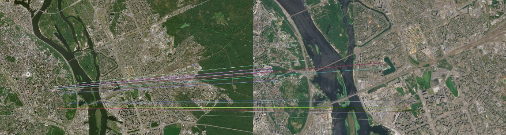
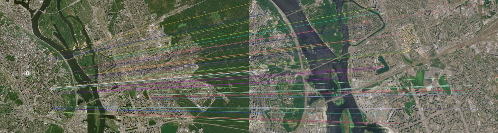
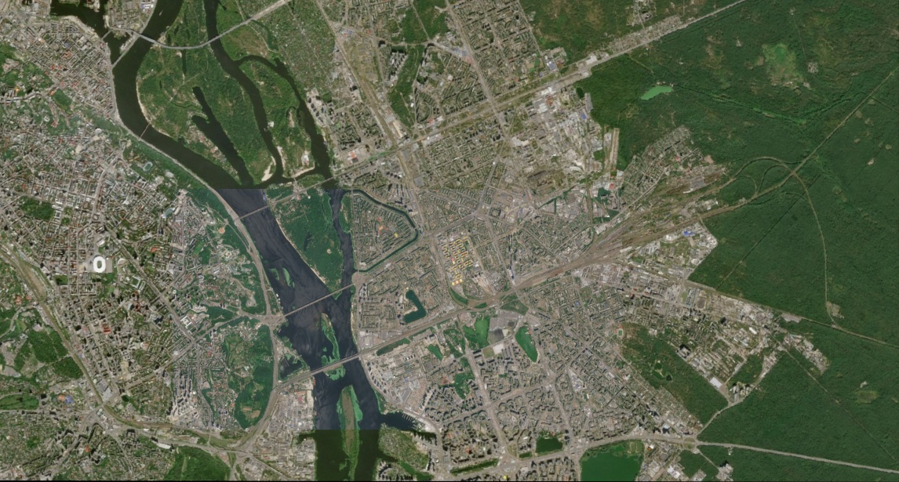
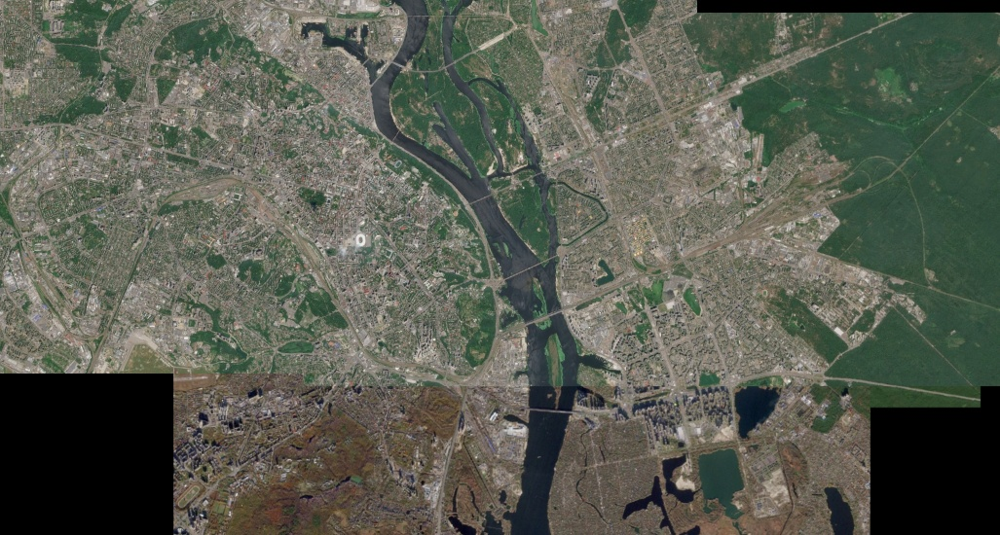

# Feature Matching for Satellite Feature-Based Panorama Stitching from Multiple Images and ORB/SIFT Comparison

The project implements a feature-based image stitching pipeline using ORB and SIFT feature detectors. It estimates image transformations with RANSAC and homography, then generates panoramas from multiple overlapping images.

## Project structure:
```text
project/
│
├── data/                      Sample input images
│   ├── 1.jpg
│   ├── 2.jpg
│   ├── 3.jpg
│   ├── 4.jpg
│   └── 5.jpg
│
├── results/
│   ├── benchmark/             Benchmark outputs
│   │   ├── orb_matches.jpg
│   │   ├── sift_matches.jpg
│   │   └── panorama.jpg
│   └── main/                  Multi-image stitching results
│       └── panorama.jpg
│
├── src/
│   ├── preprocessing.py       Image preprocessing
│   ├── orb.py                 ORB feature detection
│   ├── sift.py                SIFT feature detection
│   ├── matching.py            Feature matching and homography estimation
│   ├── stitching.py           Panorama construction
│   └── visualization.py       Visualization utilities
│
├── benchmark.py               ORB vs. SIFT benchmark
├── main.py                    Multi-image panorama generation
├── requirements.txt
└── README.md
```

## Sample Images

The project uses a small collection of manually selected satellite images of Kyiv as input examples for image stitching.

The images were chosen to include:
- different seasons
- different viewpoints
- different scales (zoom levels)
- small rotations 
- overlapping areas suitable for feature matching and panorama generation

## Approach

The panorama generation pipeline consists of the following steps:

### 1. Image preprocessing

The input images are converted to grayscale before feature detection.

### 2. Feature detection and description

Two feature detection algorithms are evaluated:

#### ORB (Oriented FAST and Rotated BRIEF)

ORB detects image keypoints and computes binary descriptors. It is fast and uses the Hamming distance for feature matching.

#### SIFT (Scale-Invariant Feature Transform)

SIFT detects keypoints and creates more detailed descriptors. It is slower than ORB but usually finds more accurate matches. It uses the Euclidean (L2) distance to compare features.

### 3. Feature matching

Features from two images are matched using the Brute-Force (BF) matcher. ORB compares features using the Hamming distance, while SIFT uses the Euclidean (L2) distance. KNN returns the two best matches for each feature.
### 4. Lowe's Ratio Test

Lowe's Ratio Test keeps only reliable matches by comparing the two closest matches for each feature.

### 5. Homography estimation with RANSAC

RANSAC estimates the homography matrix and removes incorrect matches, keeping only reliable correspondences.

### 6. Panorama construction

The panorama size is calculated automatically based on the transformed image corners. A translation matrix shifts the image when needed to avoid cropping. Finally, the first image is warped, and the second image is added to create the panorama.
### 7. Multi-image panorama generation

To create a panorama from multiple images, the images are stitched one by one. The first image is used as the starting panorama, and each following image is matched and added to it. Images that cannot be matched are skipped.

## Usage

### Install dependencies:

```bash
pip install -r requirements.txt
```

### Compare ORB and SIFT

```bash
python benchmark.py
```

### Generate a panorama

```bash
python create_panorama.py
```

## Pipeline

```text
Images
    ↓
Feature Detection
    ↓
Feature Matching
    ↓
Lowe's Ratio Test
    ↓
RANSAC
    ↓
Homography Estimation
    ↓
Perspective Warping
    ↓
Panorama Generation
```

## Results

### ORB feature matching



### SIFT feature matching



## Metrics

| Metric |      ORB | SIFT |
|--------|---------:|-----:|
| Keypoints (Image 1) |     1000 | 1001 |
| Keypoints (Image 2) |     1000 | 1000 |
| Raw matches |     1000 | 1001 |
| Good matches |       36 | 71 |
| Inliers (RANSAC) |       27 | 59 |
| Inlier ratio |   75.00% | 83.10% |
| Execution time | 0.6651 s | 0.4652 s |

ORB finds fewer correct matches. SIFT finds more keypoints and more accurate matches, which leads to a more reliable panorama.
## Generated panorama



## Multi-image panorama generation

To generate a panorama from multiple images, five satellite images from the `data/` directory are used as input.

The images are loaded automatically and stitched sequentially using SIFT feature detection and BFMatcher with L2 distance. The first image is used as the initial panorama, and each following image is matched and merged into the current panorama.

The selected images contain overlapping areas with different viewpoints and conditions, allowing evaluation of multi-image feature-based stitching.

